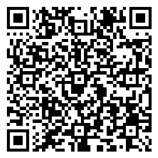

# SIGO-Dental

**Sistema Integral de Gestión Odontológica y Expediente Clínico Digital.** Proyecto académico de Ingeniería en Software.

Aplicación web para clínicas dentales: ficha del paciente con alertas médicas, agenda por sillón y profesional, odontograma y periodontograma digitales, notas clínicas inmutables con firma, consentimientos y recetas en PDF, presupuestos, caja con cierre ciego y facturación electrónica, inventario con descargo automático, honorarios, reportes y auditoría.

## Demo en línea

| | |
|---|---|
| **Aplicación** | https://sigo-dental-iyr0.onrender.com |
| **Documentación del API (Swagger UI)** | https://sigo-dental-iyr0.onrender.com/api/docs |
| **Especificación OpenAPI 3.0 (JSON)** | https://sigo-dental-iyr0.onrender.com/api/docs/openapi.json · copia en [`docs/openapi.json`](docs/openapi.json) |
| **Estado del servicio** | https://sigo-dental-iyr0.onrender.com/api/health |

> El plan gratuito de Render apaga el servicio tras 15 minutos sin uso: **el primer acceso puede tardar unos 30–60 segundos**. Al reiniciarse, la base se recrea con los datos de demostración (lo ingresado durante una prueba no persiste entre reinicios).

## Credenciales de prueba

Contraseña de **todos** los usuarios: `Demo1234!`

| Rol | Usuario | MFA | Qué puede hacer |
|---|---|---|---|
| Administrador | `admin@sigo.test` | No | **Usuarios** (alta, rol, activar/desactivar, contraseña, MFA), **catálogos** (consultorios, sillones, procedimientos, profesionales), insumos y recetas de consumo, reglas de honorarios, reportes, auditoría |
| Odontólogo | `odontologo@sigo.test` | Sí | Pacientes, agenda, expediente clínico completo (firma notas, marca procedimientos, emite recetas), presupuestos, inventario (lectura) |
| Recepcionista / Cajero | `recepcion@sigo.test` | Sí | Pacientes, agenda, caja y facturación, aprobación y agendado de presupuestos |
| Asistente dental | `asistente@sigo.test` | Sí | Pacientes, agenda (lectura), notas clínicas sin firma, inventario |
| Auditor / Contador | `auditor@sigo.test` | Sí | Reportes, liquidación de honorarios, inventario (lectura), auditoría |

### Código MFA (verificación en dos pasos)

Los roles clínicos y financieros piden, después de la contraseña, un código de 6 dígitos. Todos los usuarios de demostración comparten el secreto **`JBSWY3DPEHPK3PXP`**, así que una sola cuenta en la app sirve para los cuatro roles.

**Opción 1: escanear el QR** con Microsoft Authenticator, Google Authenticator o Authy.



**Opción 2: escribir la clave a mano.**

- **Microsoft Authenticator:**
  1. Toca **+** (Agregar cuenta) y elige **Otra cuenta (Google, Facebook, etc.)**.
  2. Se abre la cámara: toca **Escribir el código manualmente** (en iPhone, *Enter code manually*).
  3. En *Nombre de la cuenta* escribe `SIGO-Dental`, en *Clave secreta* pega `JBSWY3DPEHPK3PXP` y toca **Finalizar**.
- **Google Authenticator:** toca **+**, elige **Ingresar una clave de configuración**, escribe `SIGO-Dental` y `JBSWY3DPEHPK3PXP`, tipo **Basada en el tiempo**.

**Opción 3: desde el repositorio.** `npm run totp -w api` muestra el código vigente.

El código cambia cada 30 segundos. El administrador entra solo con contraseña.

## Datos de demostración

Cada arranque carga, a través del propio API (respetando todas las reglas de negocio):

- **8 pacientes**, con alertas críticas: alergia a penicilina, látex e ibuprofeno, y pacientes anticoagulados. Incluye 2 menores con tutor legal.
- **Agenda:** citas de hoy en todos los estados, en 3 sillones y con 2 profesionales. También la semana pasada (con inasistencias y cancelaciones) y los próximos días, que generan recordatorios.
- **Expediente clínico:**
  - Odontogramas con caries, restauraciones, endodoncias, exodoncias, prótesis e implantes, en dentición permanente y temporal.
  - Periodontogramas.
  - Notas SOEP: una firmada, una bloqueada con adenda y una editable.
  - Un consentimiento firmado y otro pendiente.
  - Una receta.
- **Presupuestos:** uno por aprobar, uno aprobado parcialmente con un ítem ya agendado, y un borrador.
- **Caja:** un turno cerrado hoy con cobros en efectivo, tarjeta, transferencia, seguro y pasarela, con un faltante de $1,00 visible en el corte de caja.
- **Inventario:** stock con un insumo bajo el mínimo y por vencer.
- **Honorarios:** procedimientos realizados listos para liquidar.

## Funcionalidades

| Módulo | Qué incluye | Requisitos |
|---|---|---|
| Usuarios | Alta con rol y contraseña segura (los odontólogos quedan como profesionales de la agenda), cambio de rol, activar/desactivar con **efecto inmediato** (el rol y el estado se verifican en cada petición), restablecer contraseña o MFA | §3 |
| Seguridad | Roles y permisos, MFA TOTP obligatorio para roles clínicos/financieros, sesión de 15 min por inactividad, refresh token rotativo, límite de intentos de login, cifrado AES-256-GCM de datos clínicos, cabeceras HTTP seguras | RNF-04, RNF-05 |
| Auditoría | Log inmutable de cada acceso (quién, qué, cuándo en ISO-8601, IP) con hash encadenado y verificación de integridad | RNF-06 |
| Pacientes | Ficha única, tutor legal obligatorio para menores, anamnesis obligatoria, **badge de alerta** en todas las pantallas | RF-01, RF-02 |
| Agenda | Vista día/semana por sillón y profesional, **sin solapamiento por sillón** (también con peticiones simultáneas), 7 estados con transiciones válidas, recordatorios 48 h/24 h | RF-09, RF-10, RF-11, RN-03 |
| Odontograma | SVG interactivo, 32 permanentes y 20 temporales, numeración **FDI ⇄ Universal**, 5 superficies, catálogo de hallazgos por color | RF-03 |
| Periodontograma | 6 sitios por diente, recesión, **NIC calculado**, furca, movilidad, sangrado | RF-04 |
| Notas SOEP | Inmutables tras la firma (con contraseña) o tras 24 h; correcciones solo por **adenda firmada** | RF-05 |
| Procedimientos | Lo realizado no se puede modificar ni borrar (también bloqueado en la base de datos) | RN-01 |
| Consentimiento | Plantilla por procedimiento, firma en pantalla táctil o **OTP**, PDF con sello de integridad; firma el tutor si es menor | RF-06 |
| Recetas | PDF; aviso si el medicamento coincide con una alergia registrada | §8.1 |
| Presupuestos | Fases y sesiones, laboratorio, honorarios, descuento autorizado, aprobación **total o parcial** y paso a citas | RF-07, RF-08 |
| Caja | Pagos mixtos, **cierre ciego**, factura electrónica XML con clave de acceso de 49 dígitos (SRI simulado), pasarela de pagos simulada | RF-12, RN-02 |
| Inventario | Lotes por consultorio, stock mínimo, vencimientos, **descargo automático y transaccional** al realizar un procedimiento | RF-14 |
| Honorarios | Porcentaje, monto fijo o porcentaje neto de costos, calculado al centavo; cada procedimiento se liquida una sola vez | RF-13 |
| Reportes | Corte de caja, honorarios, inventario valorizado y ausentismo, exportables a CSV | §3 |

Las integraciones externas (SRI, WhatsApp/SMS/correo, pasarela de pagos) funcionan con **adaptadores simulados** detrás de una interfaz, listos para conectar el proveedor real.

## Documentación técnica del API (OpenAPI / Swagger 3.0)

- **Especificación OpenAPI 3.0.3:** [`docs/openapi.json`](docs/openapi.json), también publicada en `/api/docs/openapi.json`. Documenta las 67 rutas con:
  - esquemas de datos;
  - parámetros;
  - cuerpos de petición con ejemplos;
  - respuestas de error;
  - el permiso que requiere cada operación.
  - Se valida automáticamente en las pruebas, y un test comprueba que el archivo esté al día con el código.
- **Swagger UI:** `/api/docs`. Para probar endpoints protegidos:
  1. Ejecuta `POST /api/auth/login` (y `POST /api/auth/login/mfa` con el código TOTP si corresponde).
  2. Copia el `token`.
  3. Pulsa **Authorize** y pégalo.
- **Postman / Insomnia:** importa `docs/openapi.json`.
- **Convenciones:**
  - Importes en centavos (enteros).
  - Porcentajes de honorarios en puntos básicos (4000 = 40 %).
  - Fechas ISO-8601.
  - Dientes en notación FDI.
  - Errores con el formato `{ "error": "…" }`.
- Regenerar el archivo tras cambiar el API: `npm run openapi -w api`.

## Arquitectura y stack

| Capa | Tecnología |
|---|---|
| Frontend | React 18 + Vite + TypeScript + Tailwind CSS (SPA servida por el mismo backend) |
| Backend | Node.js 22 + Express 5 + TypeScript, validación con Zod |
| Datos | SQLite + Prisma (migrable a PostgreSQL cambiando el `provider`) |
| Seguridad | JWT + refresh rotativo, bcrypt, TOTP (otplib), AES-256-GCM, helmet, express-rate-limit |
| Documentos | pdfkit (PDF), XML de factura electrónica |
| Pruebas | Vitest + Supertest, autocannon (carga), prueba E2E contra producción |
| CI/CD | GitHub Actions (lint, typecheck, tests, build, auditoría de dependencias) · despliegue en Render |

Es un monolito modular: la versión simplificada de la arquitectura del SRS §7. Detalle en [`docs/architecture.md`](docs/architecture.md).

```
api/   Express + Prisma (src/routes = un archivo por módulo, prisma/ = esquema, migraciones, semilla y demo)
web/   React (src/pages = una pantalla por módulo)
docs/  SRS, plan, arquitectura, OpenAPI, UAT, despliegue y auditoría
```

## Ejecución local

Requisitos: Node.js 20 o superior.

```bash
npm install
cp api/.env.example api/.env
npm run db:migrate -w api
npm run seed
npm run demo -w api
npm run dev
```

- Web: http://localhost:5173
- API: http://localhost:3000/api/health
- Swagger: http://localhost:3000/api/docs

## Pruebas y calidad

| Comando | Qué hace | Resultado |
|---|---|---|
| `npm test` | 114 pruebas automatizadas del API | Todas pasan (también en CI) |
| `npm run coverage -w api` | Cobertura de código | 94 % de líneas; endpoints críticos > 80 % |
| `npm run e2e -w api` | Prueba funcional de punta a punta contra producción (`BASE_URL=…` para otro entorno) | 21/21 pasos |
| `npm run carga -w api` | 150 conexiones concurrentes | Expediente clínico: p99 < 400 ms, 0 errores |
| `npm run backup -w api` | Respaldo verificado de la base; `npm run restaurar -w api -- <archivo>` para restaurar | Probado |

Guion de pruebas de aceptación por rol, con acta para firmar: [`docs/uat.md`](docs/uat.md).

## Documentación del proyecto

| Documento | Contenido |
|---|---|
| [`docs/srs-sigo-dental.md`](docs/srs-sigo-dental.md) | Especificación de requisitos (SRS) |
| [`docs/plan-de-implementacion.md`](docs/plan-de-implementacion.md) | Plan por fases y matriz de trazabilidad |
| [`docs/architecture.md`](docs/architecture.md) | Arquitectura y decisiones de seguridad |
| [`docs/openapi.json`](docs/openapi.json) | Especificación OpenAPI 3.0 del API |
| [`docs/uat.md`](docs/uat.md) | Guion de UAT por rol y acta de aceptación |
| [`docs/auditoria-fase4.md`](docs/auditoria-fase4.md) | Auditoría de seguridad, cobertura, carga y respaldo |
| [`docs/despliegue.md`](docs/despliegue.md) | Despliegue en Render, variables y rollback |

## Limitaciones conocidas

- **Persistencia:** en el plan gratuito de Render la base se reinicia con cada reinicio del servicio. Para conservar datos se usa Render Postgres o un disco persistente; ver [`docs/despliegue.md`](docs/despliegue.md).
- **Integraciones simuladas:** SRI, mensajería y pasarela de pagos no se conectan a proveedores reales.
- **Firma de notas:** se usa firma simple (re-autenticación y sello HMAC), no un certificado de firma electrónica `.p12`.
- **Credenciales públicas:** las credenciales y el secreto MFA de demostración son públicos a propósito. No usar este despliegue con datos reales.
